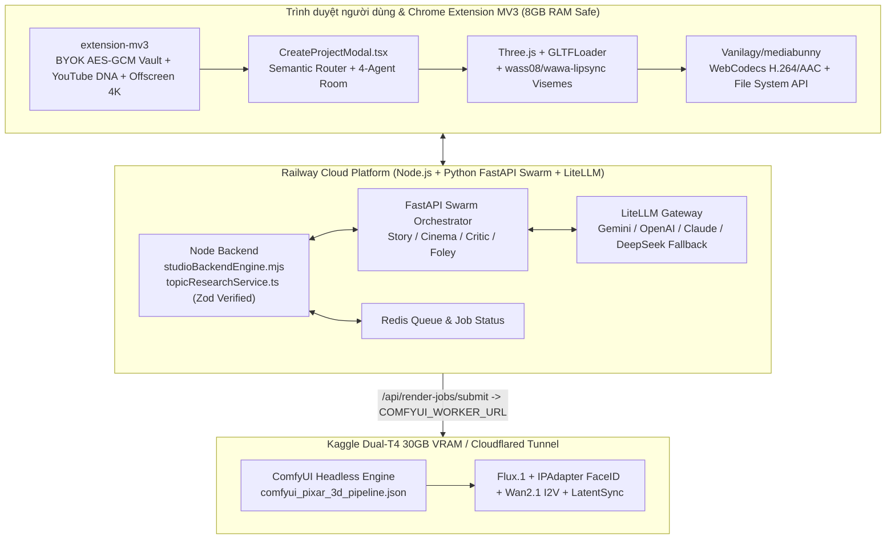

# Synapes Auto Video Studio — Production Architecture v7.0

Kiến trúc phân tách hoàn toàn **Zero-Local-RAM Compute** dành cho máy phát triển 8GB RAM (Acer Aspire A514-54), kết hợp **3-Tier Anti-Fake Guardrails**, **Multi-Agent Writers' Room**, **Chrome/Edge Extension MV3**, và **Cloud Railway + Kaggle Dual-T4 ComfyUI GPU Worker**.

## Các thành phần nâng cấp trọng tâm
1. **3-Tier Anti-Fake Activity Guardrails**: `.cursorrules`, `.clinerules`, `AGENTS.md`, `.semgrep/no-fake-activity.yml`, `tests/anti-fake-activity.test.ts` (Vitest), `tests/e2e/anti-fake-activity.spec.ts` (Playwright), `.github/workflows/quality-gate.yml`.
2. **Semantic Intent Router & Multi-Agent Writers' Room**: Tự động phân luồng Tin tức/Tài chính, Hoạt hình 3D Kids (tự động khóa tìm ảnh Wikimedia & bật nhãn COPPA Made for Kids), và Khoa học/Toán học Manim+Three.js.
3. **Real-time 3D Lip-Sync & Zero-OOM WebCodecs Export**: Nạp nhân vật `.glb` qua `GLTFLoader`, phân tích âm thanh thời gian thực qua `wawa-lipsync`, đóng gói MP4 H.264/AAC trực tiếp ra ổ đĩa qua `mediabunny` + `StreamTarget`.
4. **Companion Extension Manifest V3**: Mã hóa khóa BYOK bằng `AES-GCM` 256-bit cục bộ, bóc tách DNA YouTube/TikTok, tách nền nhân vật 1 chạm, Offscreen 4K Export & Native Messaging FFmpeg.
